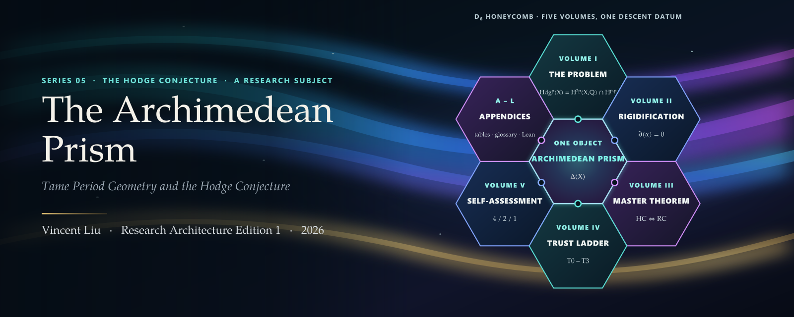
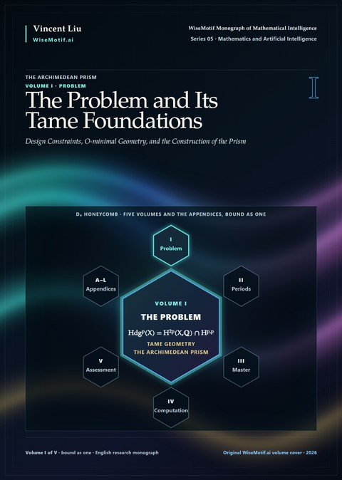
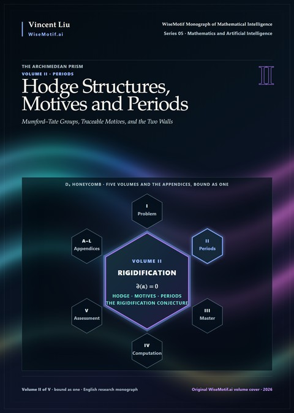
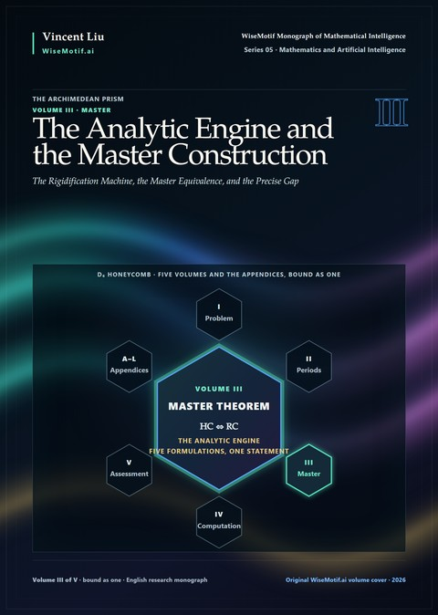
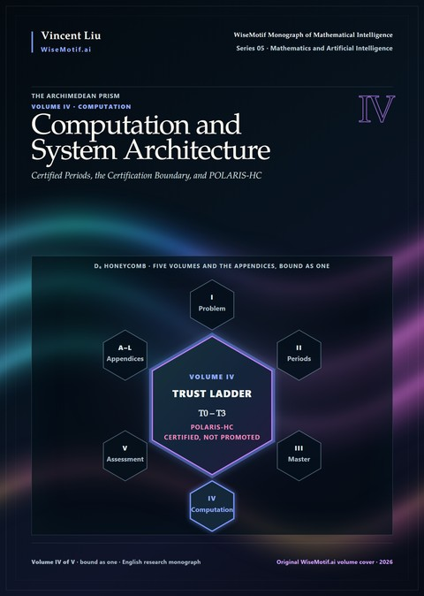
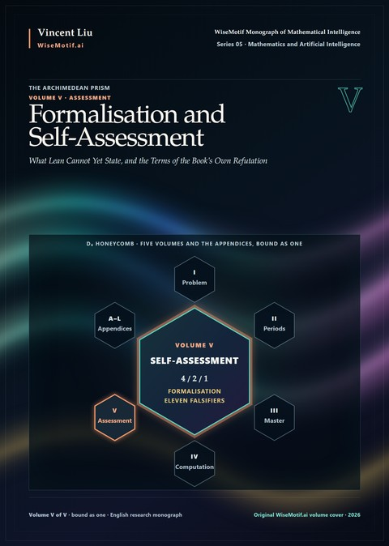
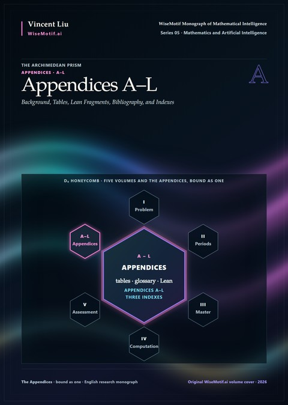
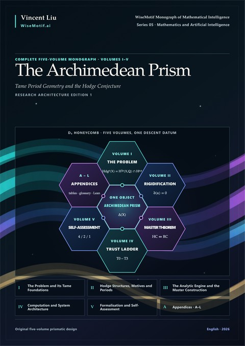

<p align="center">
  <a href="https://doi.org/10.5281/zenodo.23597954"></a>
</p>

<p align="center">
  <a href="https://doi.org/10.5281/zenodo.23597954"></a>
  <a href="https://creativecommons.org/licenses/by-nc-nd/4.0/"></a>
  <a href="https://github.com/AlienMuse/the-archimedean-prism/releases/tag/v1.0.0"></a>
  
  
  
  <a href="VERIFY.md"></a>
  <a href="VERIFY.md"></a>
</p>

<p align="center">
  <b><a href="https://github.com/AlienMuse/the-archimedean-prism/releases/download/v1.0.0/The-Archimedean-Prism-v1.0.0-Preview.pdf">Read the preview</a></b> (129 pages, 72.2 MB) ·
  <a href="#download">Download</a> ·
  <a href="#the-five-volumes">Volumes</a> ·
  <a href="#citation">Cite</a> ·
  <a href="VERIFY.md">Verify</a> ·
  <a href="README.zh-CN.md">中文</a>
</p>

<br>

> *Algebraicity is not a property that a cohomology class possesses; it is a descent datum that a class carries
> along a prism whose special fibre is the Hodge decomposition and whose generic fibre is the Betti lattice.*
> <br>— Preface

**The Archimedean Prism** — *Tame Period Geometry and the Hodge Conjecture* — is a monograph in five volumes bound
as one. It is the fifth work in the WiseMotif Monograph of Mathematical Intelligence and belongs to the
Grothendieckian Programme as a self-contained system: one of the Programme's research subjects, a problem on which
its method of recursive mathematical discovery is carried through in full. A structure is proposed; it is tested
against the cases in which the answer is known; what survives is abstracted and the question is posed again, in the
manner of Grothendieck's rising sea.

The problem is the Hodge Conjecture, and the question is **why it is known in codimension one, in codimension
n−1, in dimension at most three and for isolated families such as cubic fourfolds, and nowhere else; and what kind
of object would make algebraicity of a Hodge class a statement that can be tested.**

**The Hodge conjecture remains open. This work does not prove it, and proves no case of it that was not already
known.** What it offers is the state of the question after the method has been applied without concession: what
the framework would deliver, what it would need, and where each route to it stops.

<table>
  <tr>
    <td align="center"><b>5</b><br><sub>volumes,<br>bound as one</sub></td>
    <td align="center"><b>12 · 72</b><br><sub>parts ·<br>chapters</sub></td>
    <td align="center"><b>1,309</b><br><sub>pages</sub></td>
    <td align="center"><b>12</b><br><sub>axioms<br>AP1–AP12</sub></td>
    <td align="center"><b>5</b><br><sub>equivalent<br>formulations</sub></td>
    <td align="center"><b>2 of 9</b><br><sub>obstructions<br>live</sub></td>
    <td align="center"><b>36 · 206</b><br><sub>vector plates ·<br>references</sub></td>
  </tr>
</table>

## The idea: algebraicity as descent along a prism

Two theorems bound every approach from outside. Voisin's 2002 counterexample shows that the conjecture is false for
compact Kähler manifolds, and the examples of Atiyah–Hirzebruch and Kollár show that its integral form is false. Any
correct mechanism must therefore **consume projectivity at an identifiable step and produce denominators at an
identifiable step**; the four design constraints of Chapter 3 — the Voisin, Integrality, Coniveau and
Absolute-Hodge Tests — refute most proposed mechanisms before they begin.

The book changes the object. Built on o-minimal geometry — definable Chow, definable GAGA and the theorem of
Bakker–Klingler–Tsimerman — the **archimedean prism** Δ(X) of Chapter 13 is a definable bi-Rees deformation with two
commuting 𝔾<sub>m</sub>-actions whose four distinguished fibres are the Hodge decomposition, its conjugate, and the
Betti cohomology with its rational lattice. Algebraicity becomes a descent datum along the prism, governed by twelve
axioms AP1–AP12, and the Hodge Conjecture becomes the vanishing of an obstruction class ∂(α) in
H<sup>1</sup>(𝒮<sub>per</sub>, Rig).

| The method | What the book does |
|---|---|
| **Constrain** | derives four design constraints from the Kähler and integral counterexamples and runs the principal mechanisms in the literature through them (Chapter 3) |
| **Construct** | builds the tame site, the archimedean prism Δ(X), the period site and the obstruction complex (Parts I–II) |
| **Reformulate** | traceable motives and the trace–cycle map; rigidification; the Twistor–Current Rigidification Machine (Parts IV–VI) |
| **Prove** | the master equivalence of five formulations, from ten unconditional axioms (Theorem 47.3.1) |
| **Locate** | projectivity consumed at one step (Theorem 36.2.3), denominators at one step (Theorem 38.5.2), the gap as one proposition (Conjecture 51.2.1) |
| **Specify** | POLARIS-HC, a seven-layer computational system with a trust ladder; HELM, a Lean 4 proof-obligation ledger |
| **Refute** | eleven falsifiers, seven criteria fixed in advance, sixty problems (Part XI) |

## The five volumes

The five volumes and the appendices are bound as one book. Each cover below places its volume at the centre of the
D₆ honeycomb, with the formula its cell carries on the front cover of the book.

<table>
  <tr>
    <td width="33%" valign="top" align="center">
      <a href="docs/contents/volume-i.md"></a><br>
      <b>I · The Problem and Its Tame Foundations</b><br>
      <sub>Parts 0–II · 18 chapters · pp. 1–257</sub><br><br>
      <sub>The problem separated from its inequivalent siblings and audited; four design constraints derived from the two counterexamples; o-minimal structures, definable Chow and GAGA, the Bakker–Klingler–Tsimerman method and the tame site; the construction of the archimedean prism, the period site and the obstruction complex.</sub><br><br>
      <a href="docs/contents/volume-i.md">Contents</a> · <a href="https://github.com/AlienMuse/the-archimedean-prism/releases/download/v1.0.0/The-Archimedean-Prism-v1.0.0-Complete.pdf">PDF</a>
    </td>
    <td width="33%" valign="top" align="center">
      <a href="docs/contents/volume-ii.md"></a><br>
      <b>II · Hodge Structures, Motives and Periods</b><br>
      <sub>Parts III–V · 20 chapters · pp. 258–525</sub><br><br>
      <sub>Mumford–Tate groups, Hodge loci and the Cattani–Deligne–Kaplan theorem, absolute Hodge classes, Kuga–Satake; traceable motives and the trace–cycle map, whose fullness is the Trace–Hodge Conjecture; periods, the Rigidification Conjecture, and the single places where projectivity is consumed and denominators are produced.</sub><br><br>
      <a href="docs/contents/volume-ii.md">Contents</a> · <a href="https://github.com/AlienMuse/the-archimedean-prism/releases/download/v1.0.0/The-Archimedean-Prism-v1.0.0-Complete.pdf">PDF</a>
    </td>
    <td width="33%" valign="top" align="center">
      <a href="docs/contents/volume-iii.md"></a><br>
      <b>III · The Analytic Engine and the Master Construction</b><br>
      <sub>Parts VI–VII · 13 chapters · pp. 526–700</sub><br><br>
      <sub>Currents and positivity, Bishop extension, non-abelian Hodge theory, mixed Hodge modules; the Twistor–Current Rigidification Machine, whose Step B is the gap; the twelve axioms, the master equivalence, the obstruction ledger, the reduction to abelian varieties under UKS, case studies, the precise gap.</sub><br><br>
      <a href="docs/contents/volume-iii.md">Contents</a> · <a href="https://github.com/AlienMuse/the-archimedean-prism/releases/download/v1.0.0/The-Archimedean-Prism-v1.0.0-Complete.pdf">PDF</a>
    </td>
  </tr>
  <tr>
    <td width="33%" valign="top" align="center">
      <a href="docs/contents/volume-iv.md"></a><br>
      <b>IV · Computation and System Architecture</b><br>
      <sub>Parts VIII–IX · 12 chapters · pp. 701–917</sub><br><br>
      <sub>Exact algebra, Griffiths–Dwork reduction, Gauss–Manin and Picard–Fuchs, certified numerics, relation and cycle discovery; the certification boundary — PSLQ and LLL propose relations and cannot certify them; POLARIS-HC specified layer by layer, its module catalogue, the Hodge Atlas, certificates and the trust ladder.</sub><br><br>
      <a href="docs/contents/volume-iv.md">Contents</a> · <a href="https://github.com/AlienMuse/the-archimedean-prism/releases/download/v1.0.0/The-Archimedean-Prism-v1.0.0-Complete.pdf">PDF</a>
    </td>
    <td width="33%" valign="top" align="center">
      <a href="docs/contents/volume-v.md"></a><br>
      <b>V · Formalisation and Self-Assessment</b><br>
      <sub>Parts X–XI · 9 chapters · pp. 918–1047</sub><br><br>
      <sub>Why the Hodge Conjecture cannot yet be stated in Lean 4 with mathlib; a formalisation roadmap; the HELM proof-obligation ledger; the Consilium protocol and its citation audit; the falsification suite; eleven falsifiers, the verdict against seven criteria fixed in advance, sixty problems and an epilogue.</sub><br><br>
      <a href="docs/contents/volume-v.md">Contents</a> · <a href="https://github.com/AlienMuse/the-archimedean-prism/releases/download/v1.0.0/The-Archimedean-Prism-v1.0.0-Complete.pdf">PDF</a>
    </td>
    <td width="33%" valign="top" align="center">
      <a href="docs/contents/appendices.md"></a><br>
      <b>Appendices A–L</b><br>
      <sub>12 appendices · bibliography · three indexes · pp. 1048–1239</sub><br><br>
      <sub>Homological algebra, sheaf cohomology, Kähler geometry, algebraic cycles, intersection theory, o-minimality, Tannakian categories, D-modules, étale cohomology, certified numerical analysis, Lean 4 source fragments, and the tables, glossary and Index of Conjectures; indexes of notation, names and subjects.</sub><br><br>
      <a href="docs/contents/appendices.md">Contents</a> · <a href="https://github.com/AlienMuse/the-archimedean-prism/releases/download/v1.0.0/The-Archimedean-Prism-v1.0.0-Complete.pdf">PDF</a>
    </td>
  </tr>
</table>

<p align="center">
  <a href="https://github.com/AlienMuse/the-archimedean-prism/releases/download/v1.0.0/The-Archimedean-Prism-v1.0.0-Complete.pdf"></a><br>
  <b>The complete monograph</b> · Volumes I–V and Appendices A–L · 1,309 pages · 86.3 MB
</p>

## Selected results

- **The master equivalence (Theorem 47.3.1).** From the ten unconditional axioms AP1–AP10, the Hodge Conjecture,
  the Rigidification Conjecture, the Concentration Principle, the Trace–Hodge Conjecture and the split into Hodgic
  Fixed-Point Descent and Algebraic Seam Recognition are equivalent. An unconditional theorem about conjectures: it
  proves none of them.
- **The prism satisfies its axioms (Theorem 46.4.1).** AP1–AP10 hold unconditionally; AP11 holds if and only if the
  Rigidification Conjecture does.
- **Localisation of projectivity (Theorem 36.2.3)** and **of the denominators (Theorem 38.5.2).** Projectivity is
  consumed at Step B of the machine and nowhere else; the denominators forced by the integral counterexamples are
  produced at one step only. Voisin's torus fails exactly there.
- **Rigidification implies Hodge (Theorem 35.2.1)** — a conditional theorem, its hypothesis printed with it.
- **The ledger is complete (Theorem 48.6.1).** Relative to AP1–AP12 the obstructions are O1–O9 and no tenth arises;
  seven are discharged, refined or off the main line; two are live — O1, rigidification, and O2, positivity matching.
- **The trace reformulation is exact and produces no cycle (Theorem 30.3.1).** Fullness of the Hodge realisation,
  the Trace–Hodge Conjecture and the Hodge Conjecture are one statement; the reformulation relocates the difficulty.
- **The precise gap (Chapter 51).** A single proposition G, equivalent to the Hodge Conjecture, at which the
  reduction terminates.

## What this work is — and is not

**It is** a foundational proposal with its full price attached: a framework whose ten unconditional axioms are
verified, an unconditional equivalence theorem, a ledger in which every remaining difficulty has a name and a place,
and a computational and formal-verification architecture held to the level of certification it has. Every
substantive assertion carries one of four labels where it is made: **[KNOWN]** a theorem of the literature,
**[CONDITIONAL]** proved under stated hypotheses, **[NEW]** introduced in this volume, **[OPEN]** not proved by
anyone.

**It is not** a proof of the Hodge Conjecture. The equivalence proves none of its five statements; the reduction
terminates at O1 and O2. POLARIS-HC is a specification, not an implementation — the book says so itself in Chapter
70 ("Buildable is not built"). The Lean 4 fragments of Appendix K are non-compiling design targets, because the
objects needed to state the conjecture are not yet in mathlib.

## Where to start

The routes are those of the *Leitfaden*.

| Route | Chapters |
|---|---|
| shortest route (about 120 pages) | 1, 2, 3, 12, 34, 36, 47, 48, 51 |
| straight to the main theorem | 1, 12, 13, 34, 46, 47 |
| the sceptic | 2, 3, 37, 38, 51, 69, 70 |
| computational | 52–63 |
| formalisation | 64–68, with Appendix K |

A reader who distrusts the whole enterprise is invited by the Preface to begin at Chapters 69 and 70 and work
backwards.

The [preview](https://github.com/AlienMuse/the-archimedean-prism/releases/download/v1.0.0/The-Archimedean-Prism-v1.0.0-Preview.pdf) contains the front matter — Series Note, Abstract,
Preface, On the Epistemic Status of This Book, the Leitfaden, notation, acknowledgements, the contents — and the
whole of Part 0.

## The series

This work is Series 05 of the WiseMotif Monograph of Mathematical Intelligence: a self-contained system and the third research subject of the Grothendieckian Programme. The first two works of the series are bound closely together. From the third work on, each is a self-contained system on one problem, on which the Programme's method of recursive mathematical discovery is carried through in full. The Programme as a whole is set out in Series 00, its overview, which stands before the seven works and is not one of them. The overview and the seven works, in series order:

<table>
  <tr>
    <td width="96" valign="top" align="center"><a href="https://github.com/AlienMuse/grothendieckian-programme"></a></td>
    <td valign="top"><b>Series 00 · <a href="https://github.com/AlienMuse/grothendieckian-programme"><i>The Grothendieckian Programme</i></a></b><br>
      <sub><i>Recursive Mathematical Discovery in the Age of Machine Reasoning</i></sub><br>
      The Programme's overview: it stands before the seven works and is not one of them; it sets out the idea of the Programme, its architecture and what the seven share, and adds no mathematical result to them.<br>
      <sub>one book · 53 pages · <a href="https://doi.org/10.5281/zenodo.23669107">doi:10.5281/zenodo.23669107</a></sub></td>
  </tr>
  <tr>
    <td width="96" valign="top" align="center"><a href="https://github.com/AlienMuse/grothendieckian-machine"></a></td>
    <td valign="top"><b>Series 01 · <a href="https://github.com/AlienMuse/grothendieckian-machine"><i>GAI-MUA: The Grothendieckian Machine</i></a></b><br>
      <sub><i>A Mathematical Universe Architecture for Verifiable and Self-Evolving Artificial Intelligence</i></sub><br>
      The central part of the Programme: how mathematical worlds are constructed, compared and carried from one setting to another, and how a machine may hold them as typed, versioned and verifiable objects.<br>
      <sub>6 volumes · 14,905 pages · <a href="https://doi.org/10.5281/zenodo.23480696">doi:10.5281/zenodo.23480696</a></sub></td>
  </tr>
  <tr>
    <td width="96" valign="top" align="center"><a href="https://github.com/AlienMuse/topos-native-intelligence"></a></td>
    <td valign="top"><b>Series 02 · <a href="https://github.com/AlienMuse/topos-native-intelligence"><i>GM-Omega-Infinity: Topos-Native Intelligence</i></a></b><br>
      <sub><i>A Sheaf-Theoretic Architecture for Verifiable Machine Intelligence</i></sub><br>
      The meta-reasoning kernel: what an intelligence must be, internally, if it is to reason inside such worlds.<br>
      <sub>5 volumes · 4,020 pages · <a href="https://doi.org/10.5281/zenodo.23538544">doi:10.5281/zenodo.23538544</a></sub></td>
  </tr>
  <tr>
    <td width="96" valign="top" align="center"><a href="https://github.com/AlienMuse/arithmetic-spectral-descent"></a></td>
    <td valign="top"><b>Series 03 · <a href="https://github.com/AlienMuse/arithmetic-spectral-descent"><i>Arithmetic Spectral Descent</i></a></b><br>
      <sub><i>Obstruction Theory, Hodge–Krein Realization, and a Falsifiable Architecture for the Riemann Hypothesis</i></sub><br>
      Research subject 1: the Riemann Hypothesis.<br>
      <sub>4 volumes · 1,549 pages · <a href="https://doi.org/10.5281/zenodo.23564898">doi:10.5281/zenodo.23564898</a></sub></td>
  </tr>
  <tr>
    <td width="96" valign="top" align="center"><a href="https://github.com/AlienMuse/fractured-adelic-geometry"></a></td>
    <td valign="top"><b>Series 04 · <a href="https://github.com/AlienMuse/fractured-adelic-geometry"><i>Fractured Adelic Geometry</i></a></b><br>
      <sub><i>A Foundational Framework for the Birch and Swinnerton-Dyer Conjecture</i></sub><br>
      Research subject 2: the conjecture of Birch and Swinnerton-Dyer.<br>
      <sub>4 volumes · 571 pages · <a href="https://doi.org/10.5281/zenodo.23585887">doi:10.5281/zenodo.23585887</a></sub></td>
  </tr>
  <tr>
    <td width="96" valign="top" align="center"></td>
    <td valign="top"><b>Series 05 · <i>The Archimedean Prism</i></b> — this work<br>
      <sub><i>Tame Period Geometry and the Hodge Conjecture</i></sub><br>
      Research subject 3: the Hodge Conjecture.<br>
      <sub>5 volumes · 1,309 pages · <a href="https://doi.org/10.5281/zenodo.23597954">doi:10.5281/zenodo.23597954</a></sub></td>
  </tr>
  <tr>
    <td width="96" valign="top" align="center"><a href="https://github.com/AlienMuse/strained-prismatic-geometry"></a></td>
    <td valign="top"><b>Series 06 · <a href="https://github.com/AlienMuse/strained-prismatic-geometry"><i>Strained Prismatic Geometry</i></a></b><br>
      <sub><i>Deformation over the Absolute Base and the abc Conjecture</i></sub><br>
      Research subject 4: the abc conjecture.<br>
      <sub>5 volumes · 1,666 pages · <a href="https://doi.org/10.5281/zenodo.23610034">doi:10.5281/zenodo.23610034</a></sub></td>
  </tr>
  <tr>
    <td width="96" valign="top" align="center"><a href="https://github.com/AlienMuse/the-arithmetic-topos"></a></td>
    <td valign="top"><b>Series 07 · <a href="https://github.com/AlienMuse/the-arithmetic-topos"><i>The Arithmetic Topos</i></a></b><br>
      <sub><i>Foundations of a Trace-Theoretic Approach to the Langlands Programme</i></sub><br>
      Research subject 5: the Langlands programme.<br>
      <sub>5 volumes · 2,001 pages · <a href="https://doi.org/10.5281/zenodo.23629681">doi:10.5281/zenodo.23629681</a></sub></td>
  </tr>
</table>

## Download

| File | Pages | Size |
|---|---:|---:|
| [**Complete monograph**](https://github.com/AlienMuse/the-archimedean-prism/releases/download/v1.0.0/The-Archimedean-Prism-v1.0.0-Complete.pdf) — Volumes I–V and Appendices A–L | 1,309 | 86.3 MB |
| [Preview](https://github.com/AlienMuse/the-archimedean-prism/releases/download/v1.0.0/The-Archimedean-Prism-v1.0.0-Preview.pdf) — front matter and Part 0 | 129 | 72.2 MB |

The same files, with identical checksums, are archived at Zenodo: [doi:10.5281/zenodo.23597955](https://doi.org/10.5281/zenodo.23597955).
Covers are 600 ppi full-bleed; all fonts are embedded; the PDFs are linearised for fast opening.

## Citation

> Liu, V. (2026). *The Archimedean Prism — Tame Period Geometry and the Hodge Conjecture*
> (Research Architecture Edition 1, version 1.0.0). Zenodo. https://doi.org/10.5281/zenodo.23597954

```bibtex
@book{liu2026archimedeanprism,
  author    = {Liu, Vincent},
  title     = {The Archimedean Prism --- Tame Period Geometry and the {Hodge} Conjecture},
  series    = {WiseMotif Monograph of Mathematical Intelligence, Series 05},
  edition   = {Research Architecture Edition 1},
  version   = {1.0.0},
  year      = {2026},
  publisher = {Zenodo},
  doi       = {10.5281/zenodo.23597954},
  url       = {https://doi.org/10.5281/zenodo.23597954}
}
```

GitHub's *Cite this repository* button uses [CITATION.cff](CITATION.cff). The concept DOI 10.5281/zenodo.23597954 always resolves to
the latest version; cite the version DOI 10.5281/zenodo.23597955 to refer to these exact files.

## Authenticity

Every file of the release is listed in `SHA256SUMS`, signed with OpenPGP and timestamped twice (RFC 3161 and
OpenTimestamps on Bitcoin). The signing key is the same as for Series 01–04.

Signing key fingerprint: `DA1A 1AEF D8B2 C17C FF3F 1D1B 3905 0F50 7A4F EC17`

GitHub releases of this repository are immutable. Copies obtained elsewhere that do not match `SHA256SUMS` are not
authentic. Three levels of verification: [VERIFY.md](VERIFY.md).

## License and AI use

The work is licensed under [CC BY-NC-ND 4.0](LICENSE): you may share it unchanged, with attribution, for
non-commercial purposes. Translations and other uses require written permission. Details: [NOTICE.md](NOTICE.md) ·
Name use: [TRADEMARKS.md](TRADEMARKS.md).

**Text and data mining rights are reserved** under Article 4(3) of Directive (EU) 2019/790. Training or fine-tuning
machine-learning models on the work is not permitted without written permission. Individual readers may use AI
tools to read, search, explain or translate the work for their own study. Full policy:
[TDM-AND-AI-POLICY.md](TDM-AND-AI-POLICY.md).

## Contributing

A framework built on an open conjecture is only as honest as its willingness to be dismantled, and this one is
written to make dismantling easy to report. Three kinds of contribution matter most:

- **Refutation** — any of the eleven falsifiers of Chapter 69: a compact Kähler manifold to which the prism
  construction applies verbatim, a rigidifiable Hodge class that is provably non-algebraic, a tenth obstruction.
- **Construction** — progress on O1 or O2, or on any of the sixty problems of Chapter 71.
- **Reproduction** — an implementation of a POLARIS-HC module against its specification, or a Lean statement of a
  HELM obligation.

Report errors through an [errata issue](https://github.com/AlienMuse/the-archimedean-prism/issues/new?template=errata.yml). Accepted corrections are
acknowledged by name in the next edition (see [ERRATA.md](ERRATA.md)).

---

<p align="center"><sub>
  <a href="https://wisemotif.ai">WiseMotif Monograph of Mathematical Intelligence</a> · Series 05 · Mathematics and Artificial Intelligence<br>
  Series 00: <a href="https://github.com/AlienMuse/grothendieckian-programme"><i>The Grothendieckian Programme</i></a> ·
  Series 01: <a href="https://github.com/AlienMuse/grothendieckian-machine"><i>GAI-MUA: The Grothendieckian Machine</i></a> ·
  Series 02: <a href="https://github.com/AlienMuse/topos-native-intelligence"><i>GM-Omega-Infinity: Topos-Native Intelligence</i></a> ·
  Series 03: <a href="https://github.com/AlienMuse/arithmetic-spectral-descent"><i>Arithmetic Spectral Descent</i></a> ·
  Series 04: <a href="https://github.com/AlienMuse/fractured-adelic-geometry"><i>Fractured Adelic Geometry</i></a> ·
  Series 06: <a href="https://github.com/AlienMuse/strained-prismatic-geometry"><i>Strained Prismatic Geometry</i></a> ·
  Series 07: <a href="https://github.com/AlienMuse/the-arithmetic-topos"><i>The Arithmetic Topos</i></a><br>
  The official site of Grothendieck Lab and of the Grothendieckian Programme: <a href="https://grothendiecklab.com">grothendiecklab.com</a><br>
  © 2026 Vincent Liu
</sub></p>
